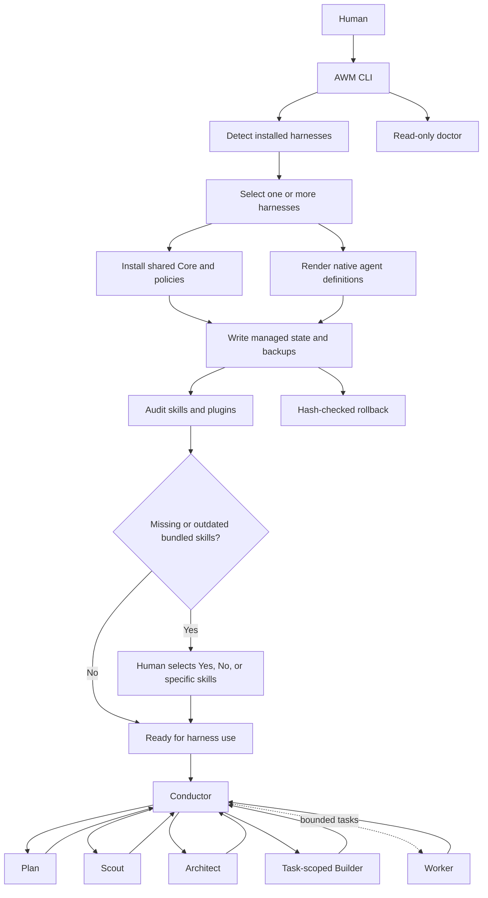

# AWM architecture

AWM separates the shared workflow contract from native harness adapters.
The CLI manages installation, capability discovery, skills, plugins, and memory checks.
The harness remains responsible for model execution and native tool permissions.

## Runtime structure

## Core and adapters

The Core defines six roles, contracts, schemas, policies, and registries.
Each adapter renders the Core into the harness's native agent format.
AWM does not create a parallel agent runtime.

| Layer | Responsibility |
|---|---|
| Core | Roles, workflow state, approval gates, contracts, schemas, engineering standards |
| Adapter | Native agent files, tool lists, permission rules, harness-specific fallbacks |
| Skill Manager | Exact IDs, frontmatter versions, declared dependencies, compatibility metadata |
| Plugin Manager | Local plugin markers and installation policy |
| Memory Manager | Read-only checks for ai-memory and Understand Anything |
| Installer | Selection, managed writes, backups, hashes, rollback |

## Permission model

OpenCode applies ordered native permission rules.
Claude Code uses tool allowlists and local pre-tool hooks.
Codex agents inherit the parent sandbox and approval settings.
OMP uses native task-agent tool and spawn allowlists.
Codex and OMP cannot enforce the same exact per-file Builder scope.
Use an isolated worktree and Human approval for those Builder sessions.

## Context model

Workspace groups repositories by product, client, team, or trust boundary.
Each Git repository receives one project identity.
Understand Anything owns repository-derived knowledge graphs.
ai-memory owns persistent session and cross-session context.
AWM audits these services without changing their live settings.

## Operational guarantees

AWM writes only beneath the selected home directory during installation.
It rejects symlink escapes and preserves unmanaged files without approval.
It records installed file hashes and skips changed files during rollback.
The read-only doctor command does not modify local configuration.
Shell effects remain outside some native file-scope controls.

## Original workflow reference

The supplied workflow diagram is preserved at `docs/reference/agentic-workflow-source.png`.
AWM keeps its original agent topology and adds Human approval gates and harness capability fallbacks.
